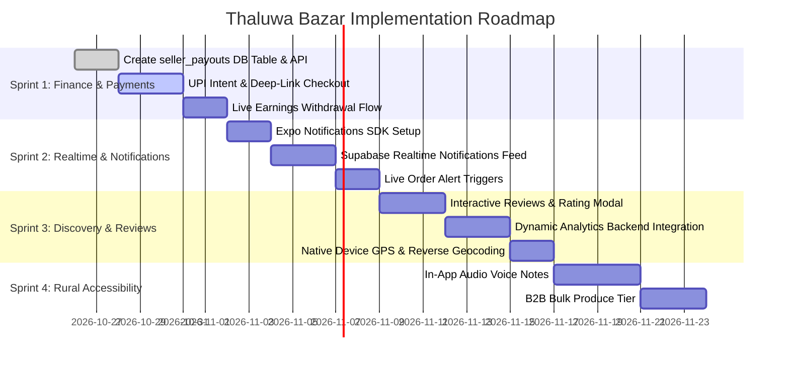

# Thaluwa Bazar (থলুৱা বজাৰ) — Feature Audit & Implementation Roadmap

> **Document Status:** Live Reference & Product Roadmap  
> **Target Platform:** Mobile App (React Native / Expo Router SDK 58), Web Admin Panel (Vite + React 18), Backend API (Node.js / Express / TypeScript), Database (Supabase PostgreSQL + PostGIS).  
> **Last Updated:** October 2026

---

## 1. Executive Summary & Current Architecture

Thaluwa Bazar is a hyperlocal rural-to-urban commerce and producer empowerment platform designed for Assam. It connects Self-Help Groups (SHGs), local farmers, and cottage industry artisans directly with nearby consumers within an adjustable 1–50 km radius.

### Active Repository Structure:
- **Mobile Client (`src/`)**: Expo Router app supporting dual roles (Buyer & Producer/Seller), bilingual internationalization (English & Assamese), PostGIS distance-based search, product catalog, cart/checkout, and order fulfillment steppers.
- **Web Admin Panel (`admin-panel/`)**: React + Vite dashboard for district coordinators and platform admins to moderate listings, verify seller KYC, manage disputes, and inspect platform GMV.
- **Backend Service (`backend/`)**: Express REST service with Supabase Admin client, JWT authentication, and PostGIS distance calculations.
- **Database (`supabase/` & `backend/src/database/`)**: PostgreSQL schema with PostGIS spatial indexing (`geography(Point, 4326)`), row-level security (RLS), and realtime change streams.

---

## 2. Feature Status Matrix

| Module | Feature | Current State | Target Priority | Technical Debt / Remaining Work |
| :--- | :--- | :---: | :---: | :--- |
| **Payments** | UPI Intent & Payment Gateway | ⚠️ Mock / UI Only | **P0** | No live Razorpay/Cashfree/UPI deep-link; orders bypass payment capture. |
| **Notifications** | Push Notifications (Expo / FCM) | ✅ Completed | **P0** | `expo-notifications` SDK 58, token auto-sync, Supabase realtime & live in-app notification feed. |
| **Finances** | Seller Payouts & Settlement | ✅ Completed | **P0** | Live Supabase `seller_payouts` ledger, real UTR generation, Admin disbursement & realtime sync. |
| **Feedback** | Product & Seller Reviews UI | ⚠️ Backend Only | **P0** | `reviews` table and API exist, but mobile has no review submission UI on completed orders. |
| **Analytics** | Producer Dashboard Analytics | ⚠️ Hardcoded Mock | **P0** | `seller/analytics.tsx` displays static `₹45,000` chart; needs dynamic order aggregation. |
| **Geolocation** | Real GPS & Assam Reverse Geocode | ⚠️ Hardcoded Fallback | **P1** | Default coordinates set to Guwahati; needs `expo-location` GPS lock & village resolver. |
| **Communication**| Buyer-Seller Direct Messaging | ⚠️ External Call Only | **P1** | Masked contact opens phone/WhatsApp; lacks in-app chat & audio voice notes. |
| **Buyer Profile** | Cloud Address Book | ⚠️ In-Memory State | **P1** | Address book in `addresses.tsx` does not persist multi-address records to Supabase. |
| **Search** | Filter Engine (Organic/In-Stock/Sort) | ⚠️ Partial Filter | **P1** | Search bar filters by text and radius; missing price sliders, organic filter, and sort orders. |
| **B2B / Commerce**| Wholesale & Bulk Orders | ❌ Backlog | **P1** | No volume tiers or Request For Quote (RFQ) for grocers and restaurants. |
| **Accessibility**| Assamese Voice Search | ❌ Backlog | **P2** | Voice query input for low-literacy rural producers and elderly buyers. |
| **Delivery** | Village Courier / Delivery Boy Role | ❌ Backlog | **P2** | Platform lacks third-party dispatch role; relies solely on self-pickup or producer delivery. |
| **Resilience** | Offline Caching & Sync | ❌ Backlog | **P2** | Offline product viewing and pending order queue for areas with weak 3G/4G connectivity. |

---

## 3. P0: Critical Missing Links & Stubs (Immediate Next Steps)

### 3.1 Real Payment Gateway & UPI Deep-Link Integration
* **Current State:** In `src/app/checkout/index.tsx`, choosing 'UPI', 'Card', or 'Netbanking' places the order immediately in the database with status `REQUESTED` without verifying payment capture.
* **Remaining Work:**
  1. **UPI Intent Deep-Linking (`upi://pay`)**:
     - Integrate zero-fee UPI deep links for Indian banking apps (Google Pay, PhonePe, Paytm, BHIM).
     - Format: `upi://pay?pa={SELLER_UPI}&pn={BUSINESS_NAME}&am={AMOUNT}&tr={ORDER_NO}&tn=ThaluwaBazarOrder`
  2. **Payment Gateway SDK**:
     - Integrate Razorpay (`react-native-razorpay`) or Cashfree React Native SDK for card, netbanking, and verified UPI webhooks.
     - Add webhook handler in `backend/src/controllers/ordersController.ts` to update `payment_status` from `pending` to `paid` upon verified signature.

---

### 3.2 Real-Time Push Notifications (Expo Notifications + FCM)
* **Current State:** `src/app/notifications.tsx` displays a static mock array (`INITIAL_NOTIFICATIONS`). If a seller accepts or delivers an order, buyers receive no device push notification when the app is closed.
* **Remaining Work:**
  1. Add `expo-notifications` and `expo-device` to mobile client.
  2. Register device push tokens on authentication and save to `users.push_token` in Supabase.
  3. Wire backend `notificationService.ts` to dispatch Expo push tickets whenever an order changes status (`REQUESTED` → `ACCEPTED` → `OUT_FOR_DELIVERY` → `COMPLETED`).
  4. Query live notifications from the Supabase `notifications` table in `src/app/notifications.tsx` with realtime subscription.

---

### 3.3 Seller Payouts Ledger & Database Migration
* **Current State:**
  - `adminController.ts` references a table called `seller_payouts`, but this table was omitted from `schema.sql`.
  - In `src/app/seller/earnings.tsx`, clicking "Withdraw to UPI" triggers a dummy `setTimeout` and resets state locally.
* **Remaining Work:**
  1. **Create `seller_payouts` Database Table:**
     ```sql
     CREATE TABLE IF NOT EXISTS seller_payouts (
       id UUID PRIMARY KEY DEFAULT gen_random_uuid(),
       seller_id UUID REFERENCES seller_profiles(id) ON DELETE CASCADE,
       amount NUMERIC(10, 2) NOT NULL,
       status VARCHAR(20) DEFAULT 'pending', -- 'pending', 'processing', 'completed', 'failed'
       upi_id VARCHAR(100) NOT NULL,
       utr_ref VARCHAR(100),
       requested_at TIMESTAMPTZ DEFAULT NOW(),
       processed_at TIMESTAMPTZ,
       created_at TIMESTAMPTZ DEFAULT NOW()
     );
     ```
  2. Connect `src/app/seller/earnings.tsx` to insert a row into `seller_payouts` when a payout is requested.
  3. Enable Admin Web Panel to view pending payout requests and approve them with UTR entry.

---

### 3.4 Interactive Reviews & Rating Submission Modal
* **Current State:** The database table `reviews` and backend `reviewsRoutes.ts` exist, but there is no mobile interface allowing a buyer to submit a rating or write feedback.
* **Remaining Work:**
  1. In `src/app/(tabs)/orders.tsx`, add a "Rate & Review" button on orders with `status === 'COMPLETED'`.
  2. Build a modal with:
     - 5-Star interactive rating selector.
     - Assamese/English text review input.
     - Optional photo attachment of delivered produce.
  3. Display average rating and review counts dynamically on `src/app/product/[id].tsx` and in the seller profile summary.

---

### 3.5 Real-Time Dynamic Seller Analytics
* **Current State:** `src/app/seller/analytics.tsx` renders static mock revenue data (`₹45,000`, `Mon: ₹3k`, `Tue: ₹6k`, etc.).
* **Remaining Work:**
  1. Build backend endpoint `GET /api/seller/analytics` or a Supabase RPC query that groups the authenticated seller's completed orders by day/week/month:
     - Total Revenue over selected window (Last 7 Days, Last 30 Days, Year-to-Date).
     - Top-selling produce items by volume and gross value.
     - Conversion rate (views vs orders).
  2. Connect `src/app/seller/analytics.tsx` to display real order data on the visual bar charts.

---

## 4. P1: High-Impact Core Enhancements

### 4.1 Live GPS Geolocation & Assam Village Reverse Geocoding
* **Current Implementation:** Location defaults to static coordinates (Guwahati: 26.1445, 91.7362).
* **Enhancement:**
  - Integrate `expo-location` to request foreground GPS permissions.
  - Implement a "Detect My Location" button in Explore header and address checkout.
  - Perform reverse geocoding to resolve the user's exact Assam District (e.g. Kamrup, Nalbari, Barpeta, Jorhat, Dibrugarh) and village locality.
  - Recalculate PostGIS distances dynamically based on user's current physical coordinates.

---

### 4.2 In-App Buyer-Seller Direct Chat with Audio Voice Notes
* **Problem:** Many rural producers (especially village SHG mothers and elder farmers) are not comfortable typing in English or Assamese script, and buyers often want to clarify produce freshness before placing an order.
* **Enhancement:**
  - In-app direct messaging channel backed by Supabase Realtime table `messages`.
  - Audio voice notes recording (`expo-av`): Allow producers and buyers to send 15–30 second voice clips.
  - WhatsApp Quick-Order template generator: Pre-fills order details in an automated WhatsApp message to the producer.

---

### 4.3 Multi-Address Persistence in Supabase
* **Current Implementation:** `src/app/addresses.tsx` holds added addresses in local component state. Newly created delivery addresses are lost when switching devices or logging out.
* **Enhancement:**
  - Add `user_addresses` table in Supabase schema:
    ```sql
    CREATE TABLE IF NOT EXISTS user_addresses (
      id UUID PRIMARY KEY DEFAULT gen_random_uuid(),
      user_id UUID REFERENCES users(id) ON DELETE CASCADE,
      name VARCHAR(100) NOT NULL,
      phone VARCHAR(20) NOT NULL,
      type VARCHAR(20) DEFAULT 'home', -- 'home', 'work', 'farm'
      street TEXT NOT NULL,
      village VARCHAR(100),
      district VARCHAR(100),
      pincode VARCHAR(10),
      landmark TEXT,
      is_default BOOLEAN DEFAULT FALSE,
      lat NUMERIC(10, 7),
      lng NUMERIC(10, 7),
      created_at TIMESTAMPTZ DEFAULT NOW()
    );
    ```
  - Bind `addresses.tsx` and Checkout screen directly to `user_addresses`.

---

### 4.4 Advanced Produce Catalog Filters
* **Enhancement:** Expand `src/app/(tabs)/explore.tsx` with a bottom sheet modal filter:
  - **Organic Certified Only**: Toggle for chemical-free / Jaivik produce (`is_organic`).
  - **Price Range Slider**: Filter produce between min and max price per unit.
  - **In-Stock Only**: Filter out items where `stock <= 0` or status is `sold_out`.
  - **Sort Order**: "Distance: Nearest First", "Price: Low to High", "Highest Rated", "Recently Harvested".

---

### 4.5 B2B Bulk & Wholesale Produce Tier
* **Context:** Local restaurants, hostel messes, grocery retailers, and catering businesses in Assam frequently purchase rice, ginger, turmeric, mustard oil, and vegetables in bulk quantities (quintals/sacks).
* **Enhancement:**
  - Add wholesale unit configurations on listings (`unit: 'quintal' | 'crate' | 'sack' | 'bulk_kg'`).
  - Volume tiered pricing (e.g. 1–5 kg @ ₹80/kg; 20+ kg @ ₹60/kg).
  - "Request Bulk Quote" button generating a direct RFQ (Request for Quote) order flow between buyer and producer.

---

## 5. P2: Advanced Features & Rural Ecosystem Innovations

### 5.1 Assamese Voice Search & Conversational Ordering
* Voice search input bar in `explore.tsx`.
* Integrates speech-to-text allowing users to speak in Assamese (e.g. *"মোক ২ কেজি জহা চাউল আৰু খাঁটি সৰিয়হৰ তেল লাগে"*) and parses produce keywords using natural language processing to match category and listing tags.

### 5.2 Offline Mode & Rural Sync Queue
* Weak or intermittent cellular connectivity in rural interiors.
* Cache the nearest active catalog locally using `@react-native-async-storage/async-storage` or WatermelonDB.
* Allow sellers to draft new listings and confirm orders offline, queuing mutations to sync automatically once back in 4G/Wi-Fi coverage.

### 5.3 Local Village Delivery Partner ("Village Delivery Hero") Role
* Third user role for rural youth with bicycles/motorcycles.
* Village Delivery Partners earn per-kilometer commission delivering packages from SHG farm clusters to urban drop points or pickup centers.
* Real-time GPS delivery tracking screen with map route rendering via Google Maps / MapLibre.

### 5.4 SMS & WhatsApp Transactional Fallbacks
* Dual-channel notification system: If an order remains unaccepted after 15 minutes, trigger an automated SMS / WhatsApp notification via Gupshup / Twilio / Fast2SMS to the producer's mobile number, ensuring no orders are missed.

### 5.5 Organic Quality Certification & SHG Verification Badges
* Admin portal ability to attach verified inspection certificates (e.g., FSSAI, Organic PGS-India, Assam State Rural Livelihoods Mission - ASRLM endorsement).
* Verified badge icon with modal displaying the certifying agency and village cluster details.

---

## 6. Recommended Next Sprint Plan



---

## 7. Immediate Action Checklist

- [ ] **Database**: Execute `seller_payouts` and `user_addresses` migration script on Supabase.
- [ ] **Mobile App**: Replace checkout simulated placement with UPI deep-link intent trigger.
- [ ] **Mobile App**: Replace mock `INITIAL_NOTIFICATIONS` in `src/app/notifications.tsx` with live database query.
- [ ] **Mobile App**: Connect `src/app/seller/earnings.tsx` to trigger real payout records in `seller_payouts`.
- [ ] **Mobile App**: Build "Rate Order" star rating modal on completed orders in `src/app/(tabs)/orders.tsx`.
- [ ] **Admin Web**: Enable Admin Payouts table view and UTR disbursement action.
