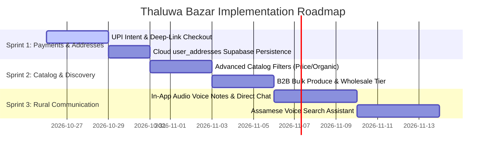

# Thaluwa Bazar (থলুৱা বজাৰ) — Feature Audit & Implementation Roadmap

> **Document Status:** Live Reference & Product Roadmap  
> **Target Platform:** Mobile App (React Native / Expo Router SDK 58), Web Admin Panel (Vite + React 18), Backend API (Node.js / Express / TypeScript), Database (Supabase PostgreSQL + PostGIS).  
> **Last Updated:** October 2026

---

## 1. Executive Summary & Current Architecture

Thaluwa Bazar is a hyperlocal rural-to-urban commerce and producer empowerment platform designed for Assam. It connects Self-Help Groups (SHGs), local farmers, and cottage industry artisans directly with nearby consumers within an adjustable 1–50 km radius.

### Active Repository Structure:
- **Mobile Client (`src/`)**: Expo Router app supporting dual roles (Buyer & Producer/Seller), bilingual internationalization (English & Assamese), PostGIS distance-based search, product catalog, cart/checkout, and order fulfillment steppers.
- **Web Admin Panel (`admin-panel/`)**: React + Vite dashboard for district coordinators and platform admins to moderate listings, verify seller KYC, manage disputes, inspect platform GMV, and audit administrative events.
- **Backend Service (`backend/`)**: Express REST service with Supabase Admin client, JWT authentication, audit logging engine, and PostGIS distance calculations.
- **Database (`supabase/` & `backend/src/database/`)**: PostgreSQL schema with PostGIS spatial indexing (`geography(Point, 4326)`), row-level security (RLS), and realtime change streams.

---

## 2. Feature Status Matrix (Remaining & Pending Roadmap)

| Module | Feature | Current State | Target Priority | Technical Debt / Remaining Work |
| :--- | :--- | :---: | :---: | :--- |
| **Payments** | Razorpay Gateway & UPI Intent | ✅ Complete | **P0** | Standard Razorpay REST order generation, in-app checkout modal (UPI, Cards, Netbanking), HMAC-SHA256 signature verification, and transaction ledger. |
| **Communication**| Buyer-Seller Direct Messaging | ✅ Complete | **P1** | In-app direct chat, 30s voice notes via `expo-audio`, Realtime WebSocket, WhatsApp quick-orders. |
| **Buyer Profile** | Cloud Address Book | ✅ Complete | **P1** | Multi-address cloud persistence via `user_addresses`, local offline fallback, and checkout chips. |
| **Search** | Filter Engine (Organic/In-Stock/Sort) | ✅ Complete | **P1** | Bottom-sheet modal with organic certification, stock availability, max price, and 5 sort criteria. |
| **Accessibility**| Native Keyboard Voice Input | ✅ Complete | **P2** | Native Google Keyboard (Gboard) / iOS voice dictation with direct search bar focus and real-time filtering. |
| **Resilience** | Offline Caching & Sync | ✅ Complete | **P2** | Local AsyncStorage catalog hydration, heartbeat network detection, pending sync queue, and `OfflineBanner`. |
| **B2B / Commerce**| Wholesale & Bulk Orders | ❌ Backlog | **P1** | No volume tiers or Request For Quote (RFQ) for grocers and restaurants. |
| **Delivery** | Village Courier / Delivery Boy Role | ❌ Backlog | **P2** | Platform lacks third-party dispatch role; relies solely on self-pickup or producer delivery. |

---

## 3. P1: High-Impact Core Enhancements (Remaining Roadmap)

### 3.1 B2B Bulk & Wholesale Produce Tier
* **Context:** Local restaurants, hostel messes, grocery retailers, and catering businesses in Assam frequently purchase rice, ginger, turmeric, mustard oil, and vegetables in bulk quantities (quintals/sacks).
* **Enhancement:**
  - Support volume-tiered pricing in `listings` (e.g., standard price ₹60/kg, 20kg+ wholesale price ₹45/kg).
  - Add "Request Bulk Quote" button allowing business buyers to send RFQs to producer SHGs.

---

### 4.2 In-App Buyer-Seller Direct Chat with Audio Voice Notes
* **Problem:** Many rural producers (especially village SHG mothers and elder farmers) are not comfortable typing in English or Assamese script, and buyers often want to clarify produce freshness before placing an order.
* **Enhancement:**
  - In-app direct messaging channel backed by Supabase Realtime table `messages`.
  - Audio voice notes recording (`expo-av`): Allow producers and buyers to send 15–30 second voice clips.
  - WhatsApp Quick-Order template generator: Pre-fills order details in an automated WhatsApp message to the producer.

---

### 4.3 Multi-Address Persistence in Supabase
* **Current Implementation:** `src/app/addresses.tsx` holds added addresses in local component state. Newly created delivery addresses are lost when switching devices or logging out.
* **Enhancement:**
  - Add `user_addresses` table in Supabase schema:
    ```sql
    CREATE TABLE IF NOT EXISTS user_addresses (
      id UUID PRIMARY KEY DEFAULT gen_random_uuid(),
      user_id UUID REFERENCES users(id) ON DELETE CASCADE,
      name VARCHAR(100) NOT NULL,
      phone VARCHAR(20) NOT NULL,
      type VARCHAR(20) DEFAULT 'home', -- 'home', 'work', 'farm'
      street TEXT NOT NULL,
      village VARCHAR(100),
      district VARCHAR(100),
      pincode VARCHAR(10),
      landmark TEXT,
      is_default BOOLEAN DEFAULT FALSE,
      lat NUMERIC(10, 7),
      lng NUMERIC(10, 7),
      created_at TIMESTAMPTZ DEFAULT NOW()
    );
    ```
  - Bind `addresses.tsx` and Checkout screen directly to `user_addresses`.

---

### 4.4 Advanced Produce Catalog Filters
* **Enhancement:** Expand `src/app/(tabs)/explore.tsx` with a bottom sheet modal filter:
  - **Organic Certified Only**: Toggle for chemical-free / Jaivik produce (`is_organic`).
  - **Price Range Slider**: Filter produce between min and max price per unit.
  - **In-Stock Only**: Filter out items where `stock <= 0` or status is `sold_out`.
  - **Sort Order**: "Distance: Nearest First", "Price: Low to High", "Highest Rated", "Recently Harvested".

---

### 4.5 B2B Bulk & Wholesale Produce Tier
* **Context:** Local restaurants, hostel messes, grocery retailers, and catering businesses in Assam frequently purchase rice, ginger, turmeric, mustard oil, and vegetables in bulk quantities (quintals/sacks).
* **Enhancement:**
  - Add wholesale unit configurations on listings (`unit: 'quintal' | 'crate' | 'sack' | 'bulk_kg'`).
  - Volume tiered pricing (e.g. 1–5 kg @ ₹80/kg; 20+ kg @ ₹60/kg).
  - "Request Bulk Quote" button generating a direct RFQ (Request for Quote) order flow between buyer and producer.

---

## 5. P2: Advanced Features & Rural Ecosystem Innovations

### 5.1 Assamese Voice Search & Conversational Ordering
* Voice search input bar in `explore.tsx`.
* Integrates speech-to-text allowing users to speak in Assamese (e.g. *"মোক ২ কেজি জহা চাউল আৰু খাঁটি সৰিয়হৰ তেল লাগে"*) and parses produce keywords using natural language processing to match category and listing tags.

### 5.2 Offline Mode & Rural Sync Queue
* Weak or intermittent cellular connectivity in rural interiors.
* Cache the nearest active catalog locally using `@react-native-async-storage/async-storage` or WatermelonDB.
* Allow sellers to draft new listings and confirm orders offline, queuing mutations to sync automatically once back in 4G/Wi-Fi coverage.

### 5.3 Local Village Delivery Partner ("Village Delivery Hero") Role
* Third user role for rural youth with bicycles/motorcycles.
* Village Delivery Partners earn per-kilometer commission delivering packages from SHG farm clusters to urban drop points or pickup centers.
* Real-time GPS delivery tracking screen with map route rendering via Google Maps / MapLibre.

### 5.4 SMS & WhatsApp Transactional Fallbacks
* Dual-channel notification system: If an order remains unaccepted after 15 minutes, trigger an automated SMS / WhatsApp notification via Gupshup / Twilio / Fast2SMS to the producer's mobile number, ensuring no orders are missed.

### 5.5 Organic Quality Certification & SHG Verification Badges
* Admin portal ability to attach verified inspection certificates (e.g., FSSAI, Organic PGS-India, Assam State Rural Livelihoods Mission - ASRLM endorsement).
* Verified badge icon with modal displaying the certifying agency and village cluster details.

---

## 6. Recommended Next Sprint Plan



---

## 7. Immediate Action Checklist

- [ ] **Mobile App**: Replace checkout simulated placement with native UPI deep-link intent trigger (`upi://pay?pa=...`).
- [x] **Database**: Added `user_addresses` schema migration in `backend/src/database/schema.sql`.
- [x] **Mobile App**: Connected `src/app/addresses.tsx` and Checkout address picker to live `user_addresses` with `AsyncStorage` offline resilience.
- [x] **Mobile App**: Added `FilterModal` in `explore.tsx` with organic produce toggle, in-stock filter, price limit presets, and dynamic sort order.
